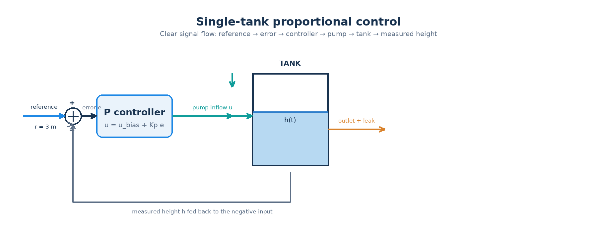
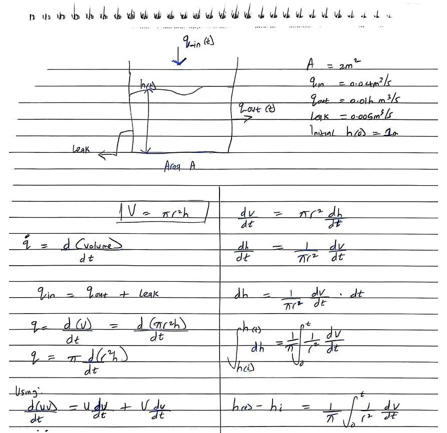
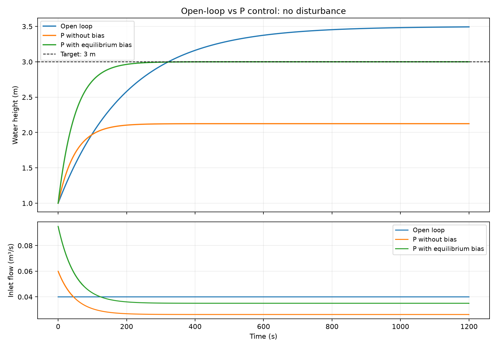
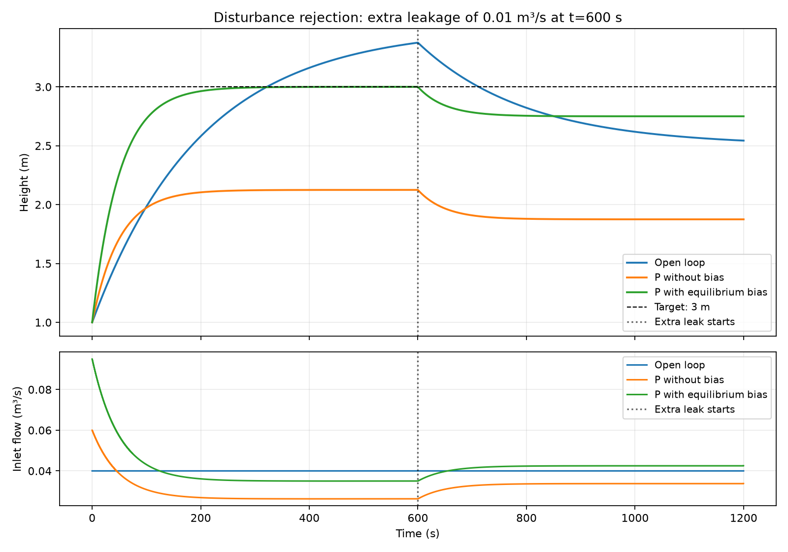
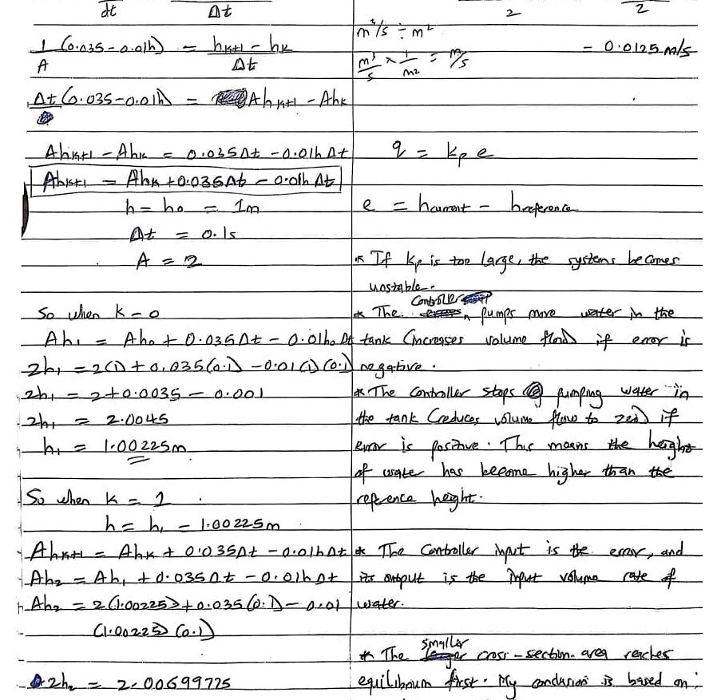

# Proportional control: what feedback can — and cannot — fix

> **01 · Single tank / P · Engineering report**

Mathematical model, verified Python results, equilibrium bias, and the permanent error left by an unmodelled disturbance.

[Open the interactive proportional-control companion](https://control-lab-alpha.vercel.app/) · [Open the shareable web report](https://control-lab-alpha.vercel.app/p-control-report)

  

<em>Figure 1. The pump adjusts inlet flow from the measured height error; outlet and leakage remove water.</em>

## Research question

Can a proportional controller keep a tank at **3 m** when normal losses are known—and what happens when an unexpected leak increases the outflow? The main lesson is that an equilibrium bias can cancel known losses, but proportional feedback alone generally needs a nonzero tracking error to overcome a new constant disturbance.

## 1. System specification and assumptions

| Quantity | Value | Interpretation |
|---|---:|---|
| Cross-sectional area \(A\) | \(2\ \mathrm{m^2}\) | Cylindrical tank with constant area |
| Inflow (open loop) | \(0.040\ \mathrm{m^3/s}\) | Fixed before feedback control |
| Outlet coefficient \(k\) | \(0.010\ \mathrm{m^2/s}\) | \(q_{\text{out}}=kh\) |
| Nominal leak | \(0.005\ \mathrm{m^3/s}\) | Constant independent withdrawal |
| Initial height | \(1\ \mathrm{m}\) | Reference step begins below target |
| Reference / pump limits | \(3\ \mathrm{m}\) / \(0\text{–}0.100\ \mathrm{m^3/s}\) | Actuator saturation model |

The water balance is

$$
A\frac{dh}{dt}=u-kh-q_{\text{leak}}.
$$

The accumulation term is \(A\,dh/dt\) because the stored volume is \(V=Ah\). The model uses a linear outlet and a constant leak; it excludes sensor noise, actuator lag, overflow, and dry-out.

  

<em>Figure 2. Original handwritten tank derivation, contrast-enhanced. The report uses corrected conservation notation.</em>

## 2. Why the bias is needed

The measured error and constrained proportional command are

$$
e=r-h,
\qquad
u=\operatorname{clip}\!\left(q_{\text{bias}}+K_pe,\ 0,\ 0.100\right).
$$

With \(r=3\ \mathrm{m}\), \(K_p=0.03\ \mathrm{m^2/s}\), and the nominal leak of \(0.005\ \mathrm{m^3/s}\), the balancing flow is

$$
q_{\text{bias}}=kr+q_{\text{leak}}=0.035\ \mathrm{m^3/s}.
$$

At \(h=1\ \mathrm{m}\), the initial command is

$$
0.035+0.03(3-1)=0.095\ \mathrm{m^3/s},
$$

which is within the pump limit.

For an unsaturated controller, the predicted equilibrium is

$$
h_{\text{eq}}
=
\frac{q_{\text{bias}}+K_pr-q_{\text{leak}}}{k+K_p}.
$$

| Scenario | Predicted equilibrium | Interpretation |
|---|---:|---|
| No bias, no added leak | \(2.125\ \mathrm{m}\) | Large permanent offset |
| Bias \(=0.035\), nominal leak | \(3.000\ \mathrm{m}\) | Nominal target maintained |
| Bias + extra leak \(0.010\) | \(2.750\ \mathrm{m}\) | \(0.250\ \mathrm{m}\) permanent offset |

## 3. Reproduced implementation results

The archived Phase 2 Python project evaluates the controller once per \(0.1\ \mathrm{s}\) step, holds the inlet command over that step, and advances the tank using Forward Euler. The archived test suite was executed during the report preparation: **11 of 11 tests passed**.

  

<em>Figure 3. Existing project output: open loop, P without bias, and biased P, showing water height and executed inlet flow.</em>

For the unsaturated, biased nominal system, the closed-loop time constant is

$$
\tau_{\text{closed-loop}}=\frac{A}{k+K_p}=50\ \mathrm{s},
$$

compared with \(200\ \mathrm{s}\) for the original open-loop model. The archived run reports a \(2\ \mathrm{cm}\) reference band reached and maintained at approximately **230.1 s**.

## 4. Persistent-leak experiment

At \(t=600\ \mathrm{s}\), the existing simulation increases leakage by \(0.010\ \mathrm{m^3/s}\). The biased P controller eventually settles at \(2.75\ \mathrm{m}\); the permanent shortfall is \(0.25\ \mathrm{m}\). Its pump output rises enough to balance the new losses at *that lower height*, not at \(3\ \mathrm{m}\).

  

<em>Figure 4. Existing project output: a step increase in leakage reveals the P controller’s nonzero disturbance offset.</em>

## 5. Hand calculation to code

  

<em>Figure 5. Handwritten Forward Euler update and proportional-control reasoning. The model below is the checked reference.</em>

The implemented Forward Euler state update is

$$
h_{n+1}
=
h_n+\Delta t
\frac{u_n-kh_n-q_{\text{leak},n}}{A}.
$$

The same calculation appears directly in the Python implementation:

~~~python
error = target - height[k]
u_raw = bias + kp * error
u = np.clip(u_raw, 0.0, pump_max)
rate = (u - outlet_k * height[k] - leak[k]) / area
height[k + 1] = height[k] + dt * rate
~~~

## 6. Verification, reproducibility and limitations

From the workspace root, install the requirements, reproduce the Phase 2 plots, and run the regression tests:

~~~bash
make setup
PYTHONPATH=projects/01-water-tank/src \
  python -m water_tank.feedback_control
PYTHONPATH=projects/01-water-tank/src \
  python -m unittest discover -s projects/01-water-tank/tests -v
~~~

This report includes existing code-generated images; it is not a claim that the web demonstration and the Python archive are the same runtime.

- Control is sampled; the underlying physics is idealized.
- Bias delivers zero error only for the known nominal leakage and target.
- A permanent unknown disturbance moves the P equilibrium, so PI is the logical next comparison.

**Source distinction:** numerical results and the test count in this report come from the existing single-tank Python archive.

**Interactive illustration:** [Control Lab proportional page](https://control-lab-alpha.vercel.app/).
