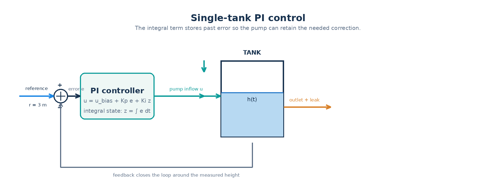
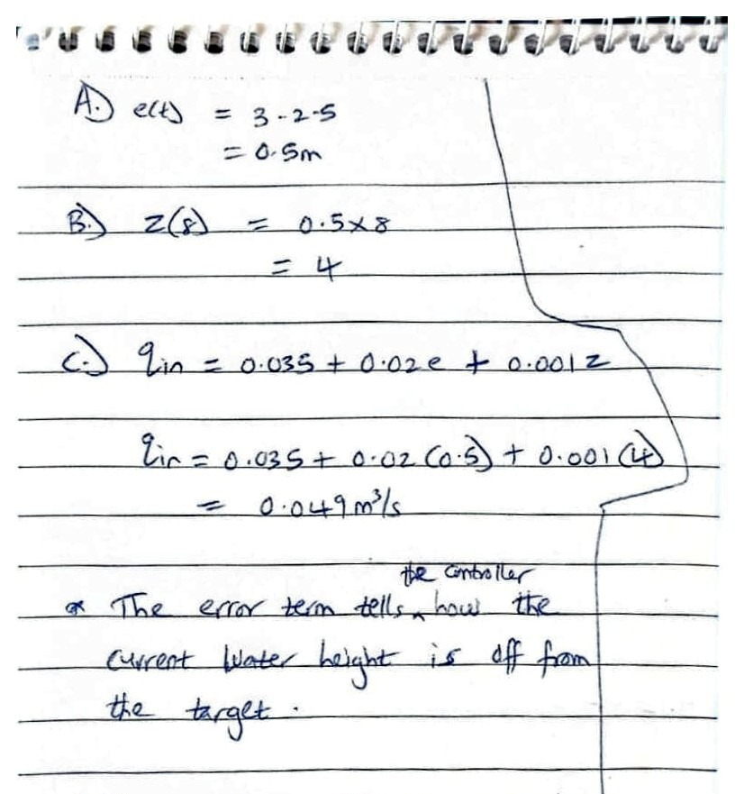
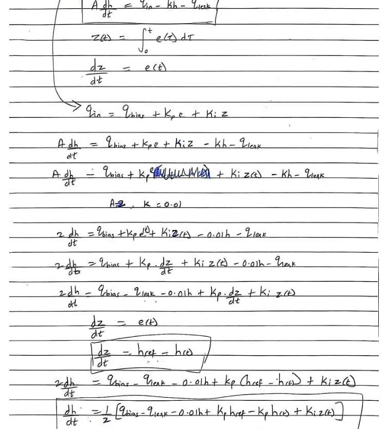
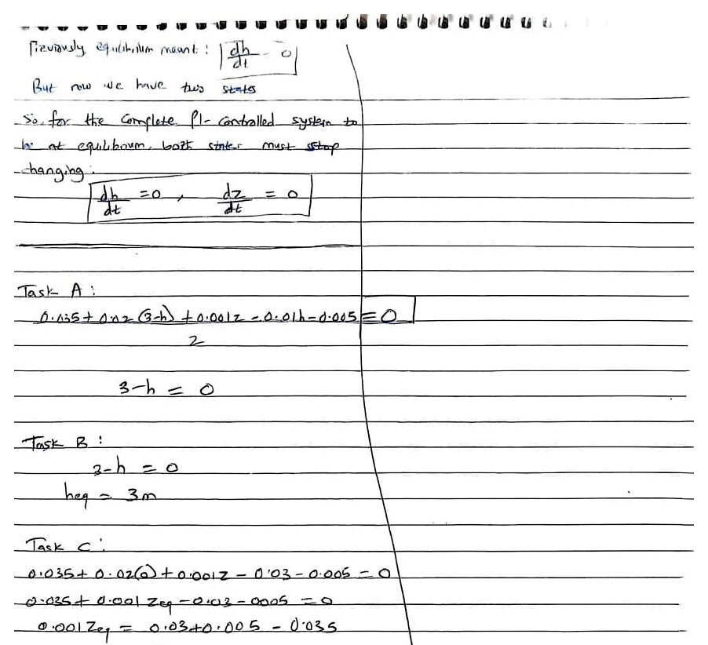
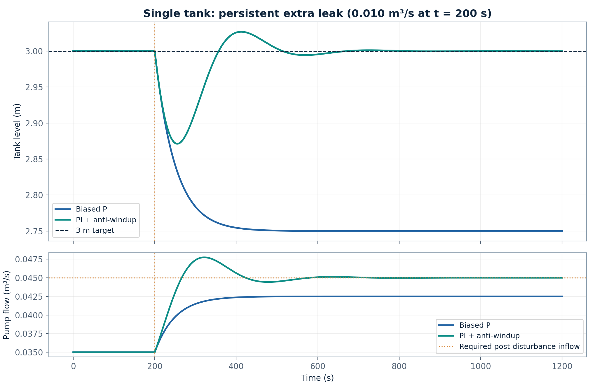
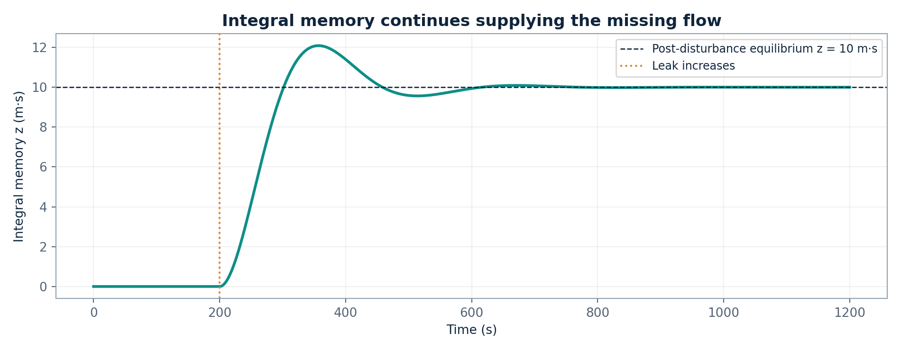
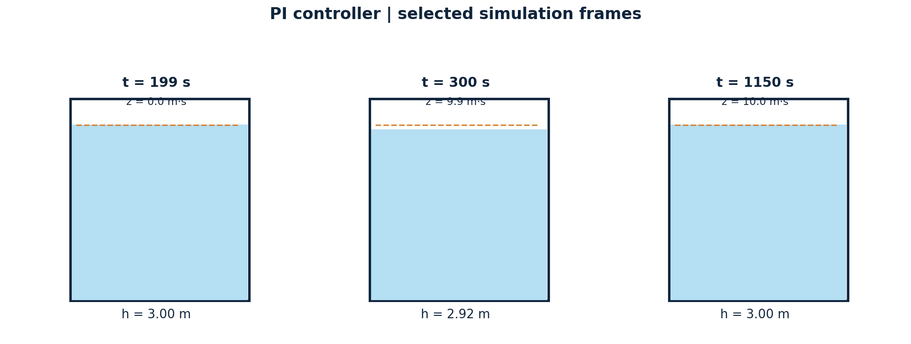

# PI control: turning persistent error into corrective memory

> **02 · Single tank / PI · Engineering report**

A second state makes the pump retain the correction needed for a constant unknown leak, without demanding a permanent height offset.

[Open the interactive PI companion](https://control-lab-alpha.vercel.app/pi-control) · [Open the shareable web report](https://control-lab-alpha.vercel.app/pi-control-report)

  

<em>Figure 1. In PI control, the inlet command depends on both the instantaneous height error and the integral-memory state.</em>

## 1. From P limitation to PI objective

Under biased P control, an added \(0.010\ \mathrm{m^3/s}\) persistent leak moved the steady water level from \(3.00\ \mathrm{m}\) to \(2.75\ \mathrm{m}\). Here the objective is to restore \(3.00\ \mathrm{m}\) while retaining the added pump flow necessary to replace the leakage. The single-tank physical model remains unchanged:

$$
A\dot h=u-kh-q_{\text{leak}},
\qquad
e=3-h.
$$

## 2. Introduce integral memory as a state

$$
z(t)=\int_0^t e(\tau)\,d\tau,
\qquad
\dot z=e(t).
$$

The integral state \(z\) has units of \(\mathrm{m\,s}\). If the height remains \(0.5\ \mathrm{m}\) below target for \(8\ \mathrm{s}\) and \(z\) begins at zero, then \(z(8)=4\ \mathrm{m\,s}\). It is an accumulated quantity; \(z\) need not vanish when \(e\) becomes zero.

  

<em>Figure 2. Handwritten calculation of instantaneous error, accumulated error, and a PI pump command.</em>

The constrained command is

$$
u=\operatorname{clip}\!\left(0.035+K_p(3-h)+K_i z,\ 0,\ 0.10\right).
$$

For the illustrative response shown below, \(K_p=0.03\ \mathrm{m^2/s}\) and \(K_i=0.001\ \mathrm{m/s^2}\). The nominal bias stays \(0.035\ \mathrm{m^3/s}\), with an actuator range of \(0\text{–}0.10\ \mathrm{m^3/s}\).

## 3. The coupled state equations

Substituting PI feedback into the plant gives the two-state closed-loop model

$$
\dot h
=
\frac{0.035+K_p(3-h)+K_i z-0.01h-q_{\text{leak}}}{2},
\qquad
\dot z=3-h.
$$

The controller changes the original one-state physical model into a two-state closed-loop system \((h,z)\). Both derivatives must be evaluated at the same old state before a simultaneous Forward Euler update.

  

<em>Figure 3. The original derivation that substitutes PI feedback into conservation of volume; corrected equations are typeset above.</em>

## 4. Why integral action removes the offset

At the desired equilibrium, \(h=3\ \mathrm{m}\) and \(e=0\), yet the pump must replace both normal losses and the increased leakage. With an extra \(0.010\ \mathrm{m^3/s}\) leak, the required inflow is \(0.045\ \mathrm{m^3/s}\). The difference from the bias must come from \(K_i z\):

$$
0.035+0.001z_{\text{eq}}=0.045
\quad\Longrightarrow\quad
z_{\text{eq}}=10\ \mathrm{m\,s}.
$$

The integral state is not an error that must disappear. In this disturbed equilibrium it is precisely the extra memory needed to hold the level at the target. This conclusion requires a stable loop and sufficient pump authority.

  

<em>Figure 4. Handwritten nominal-equilibrium calculation: \(z_{\text{eq}}=0\) when the bias already replaces all nominal losses.</em>

## 5. Forward Euler and anti-windup

The simultaneous state update is

$$
h_{n+1}=h_n+\Delta t\,\dot h_n,
\qquad
z_{n+1}=z_n+\Delta t\,\dot z_n.
$$

The pump saturates at \(0\) or \(0.10\ \mathrm{m^3/s}\). Conditional anti-windup prevents \(z\) from increasing when the raw command is above maximum with positive error, or decreasing when below minimum with negative error. The integral state is allowed to unwind when the error reverses.

~~~python
e = reference - h
raw = bias + kp * e + ki * z
u = np.clip(raw, 0.0, pump_max)
blocked = (
    (raw >= pump_max and e > 0)
    or (raw <= 0.0 and e < 0)
)
zdot = 0.0 if blocked else e
hdot = (u - k * h - leak) / area
h_next = h + dt * hdot
z_next = z + dt * zdot
~~~

## 6. Independently regenerated disturbance illustration

To make the comparison readable, both P and PI runs start at nominal equilibrium \(h=3\ \mathrm{m}\), \(z=0\), with \(K_p=0.03\). Extra leakage of \(0.010\ \mathrm{m^3/s}\) begins at \(200\ \mathrm{s}\). PI uses \(K_i=0.001\); both controllers have the same bias and pump limits. Forward Euler uses \(\Delta t=0.1\ \mathrm{s}\).

  

<em>Figure 5. Locally regenerated numerical illustration: P retains a 0.25 m offset; PI returns close to 3 m by the end of this run.</em>

  

<em>Figure 6. The PI integral state approaches \(10\ \mathrm{m\,s}\), retaining the extra \(0.010\ \mathrm{m^3/s}\) correction.</em>

  

<em>Figure 7. Three static simulation frames, provided for document viewing; the animated page is linked above.</em>

| At \(1{,}200\ \mathrm{s}\) after start | P controller | PI controller |
|---|---:|---:|
| Water height | \(2.7500\ \mathrm{m}\) | \(3.0000\ \mathrm{m}\) (approx.) |
| Executed inflow | \(0.04250\ \mathrm{m^3/s}\) | \(0.04500\ \mathrm{m^3/s}\) (approx.) |
| Integral memory \(z\) | Not used | \(10.0\ \mathrm{m\,s}\) (approx.) |

## 7. Verification boundary and next step

The equilibrium values above are analytic. The figures in this report were generated from the stated Forward Euler illustration parameters. The repository implementation is verified separately and uses its documented default scenario, including a \(0.007\ \mathrm{m^3/s}\) disturbance in its primary regression case.

- PI can remove persistent steady-state offsets if the equilibrium is feasible and stable.
- The stored state \(z\) may remain nonzero when the current error is zero.
- Anti-windup is a safeguard for actuator saturation, not a way to exceed physical pump capacity.

From the workspace root:

~~~bash
make setup
PYTHONPATH=projects/01-water-tank/src \
  python -m water_tank.pi_control
PYTHONPATH=projects/01-water-tank/src \
  python -m unittest discover -s projects/01-water-tank/tests -v
~~~

The controller arithmetic, simultaneous Euler ordering, integral equilibrium, actuator clipping, disturbance rejection, and conditional anti-windup are covered by [test_pi_control.py](../../tests/test_pi_control.py).
