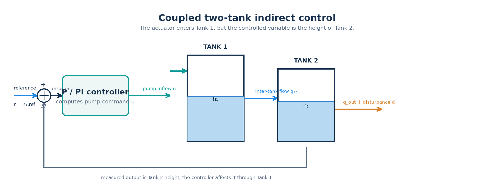
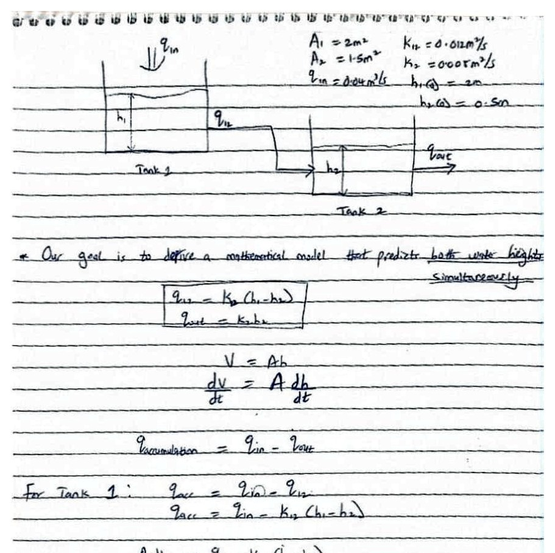
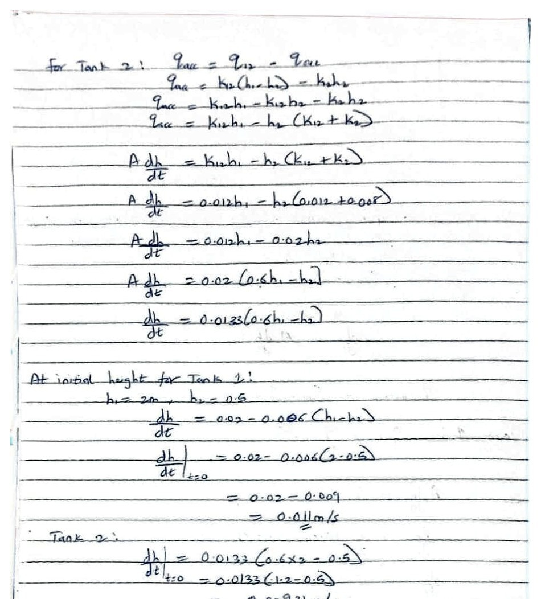
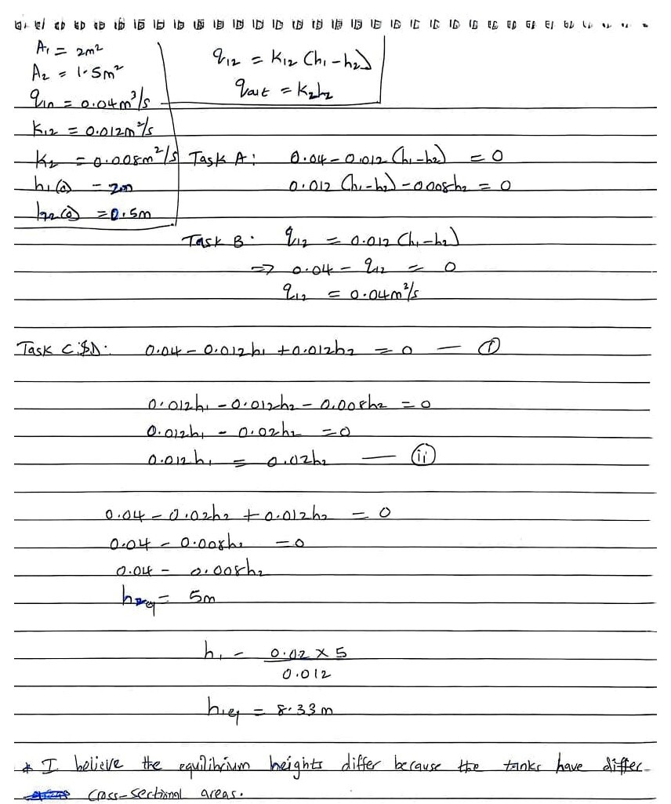
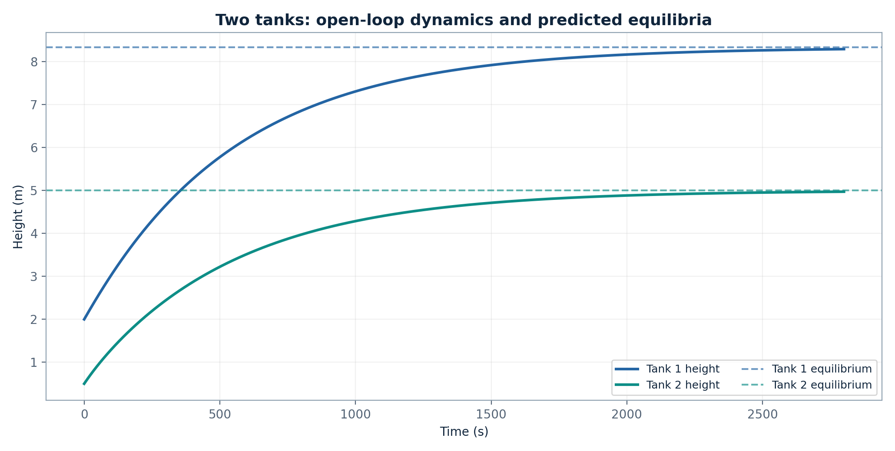
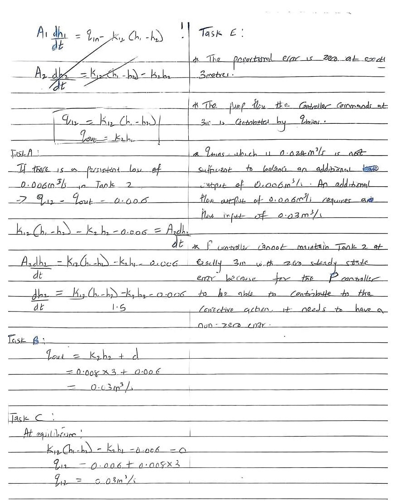
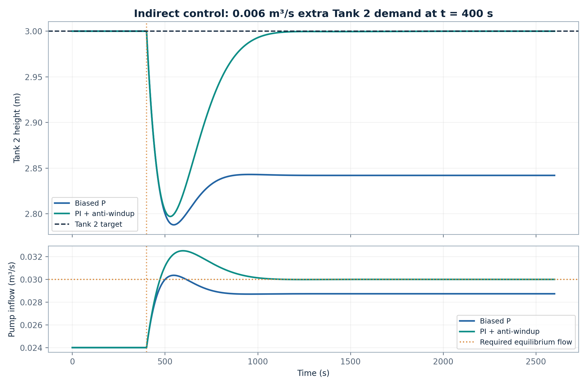
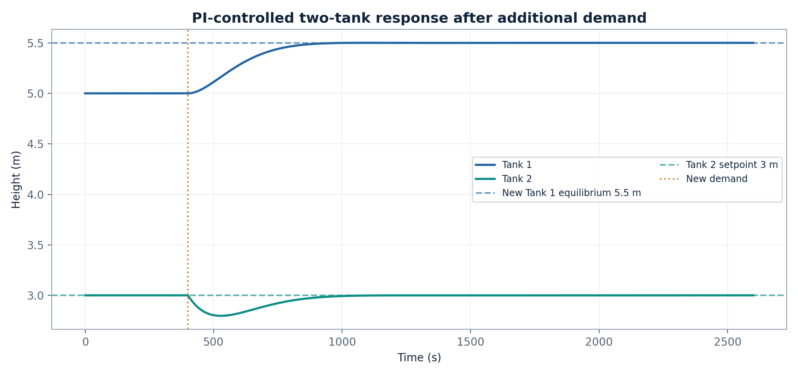
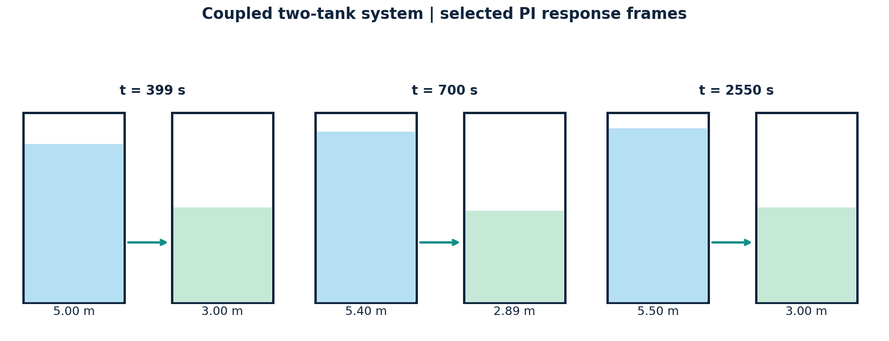

# Coupled two-tank control: one actuator, two interacting levels

> **03 · Coupled two tanks · Engineering report**

Hand-derived state equations, mass-balance verification, equilibrium operating points, and P/PI regulation of Tank 2 through Tank 1.

[Open the interactive two-tank companion](https://control-lab-alpha.vercel.app/two-tank) · [Open the shareable web report](https://control-lab-alpha.vercel.app/two-tank-report)

  

<em>Figure 1. The controller measures \(h_2\) but manipulates pump inflow into Tank 1; changing \(h_1\) alters inter-tank transfer.</em>

## 1. Physical question and assumptions

Can a single pump entering Tank 1 regulate a different, downstream tank? This introduces indirect control: the path from commanded inflow to controlled height is

$$
u\longrightarrow h_1\longrightarrow q_{12}\longrightarrow h_2.
$$

The model assumes linear head-dependent flow, constant tank areas, and a one-way link. These simplifications are teaching assumptions, not a complete hydraulic pipe model.

| Parameter | Meaning | Value |
|---|---|---:|
| \(A_1,A_2\) | Cross-sectional areas | \(2.0,\ 1.5\ \mathrm{m^2}\) |
| \(k_{12}\) | Inter-tank flow coefficient | \(0.012\ \mathrm{m^2/s}\) |
| \(k_2\) | Tank 2 outlet coefficient | \(0.008\ \mathrm{m^2/s}\) |
| \(u\), open loop | Constant inlet flow | \(0.040\ \mathrm{m^3/s}\) |
| Initial levels | \(h_1(0),h_2(0)\) | \(2.0,\ 0.5\ \mathrm{m}\) |
| Control target | \(h_2\) reference | \(3.0\ \mathrm{m}\) |
| Pump range | Actuator limit | \(0\text{–}0.100\ \mathrm{m^3/s}\) |

## 2. Derive the coupled mass balances

The normal-regime flows are

$$
q_{12}=k_{12}(h_1-h_2),
\qquad
q_{\text{out}}=k_2h_2.
$$

The two conservation equations are

$$
A_1\dot h_1=u-q_{12},
\qquad
A_2\dot h_2=q_{12}-q_{\text{out}}.
$$

The same \(q_{12}\) leaves Tank 1 and enters Tank 2; its opposite signs guarantee that internal transfer does not create or destroy water. For the initial state, the net height rates are \(0.011\ \mathrm{m/s}\) for Tank 1 and \(0.009333\ldots\ \mathrm{m/s}\) for Tank 2.

  

<em>Figure 2. Original coupled-tank diagram and conservation equations, with contrast adjusted.</em>

  

<em>Figure 3. Hand calculation of the Tank 2 equation and the initial height rates.</em>

## 3. Open-loop equilibrium

At equilibrium,

$$
q_{\text{in,eq}}
=q_{12,\text{eq}}
=q_{\text{out,eq}}
=0.04\ \mathrm{m^3/s},
$$

$$
h_{2,\text{eq}}=5\ \mathrm{m},
\qquad
h_{1,\text{eq}}=8.333\ldots\ \mathrm{m}.
$$

The required height difference is \(0.04/0.012=3.333\ldots\ \mathrm{m}\). Tank areas affect response speed, while these particular equilibrium heights depend on inflow and flow coefficients. At equilibrium the area terms vanish because both height derivatives are zero.

  

<em>Figure 4. Handwritten equilibrium derivation; the narrative above corrects the initial area-based explanation of the height difference.</em>

  

<em>Figure 5. Locally regenerated open-loop Forward Euler simulation (\(\Delta t=0.2\ \mathrm{s}\), \(2{,}800\ \mathrm{s}\)); both levels trend toward the analytic equilibria.</em>

## 4. Select the controlled variable and operating point

The target is Tank 2 height \(h_2=3\ \mathrm{m}\). Its nominal outlet is \(0.008(3)=0.024\ \mathrm{m^3/s}\), so that is the required bias pump flow under normal conditions. The corresponding Tank 1 level must be \(5\ \mathrm{m}\), because

$$
0.024=0.012(5-3).
$$

For proportional and PI control:

$$
e=3-h_2,
\qquad
u_P=\operatorname{clip}\!\left(0.024+K_pe,\ 0,\ 0.100\right),
$$

$$
\dot z=e,
\qquad
u_{PI}=\operatorname{clip}\!\left(0.024+K_pe+K_iz,\ 0,\ 0.100\right).
$$

The PI-controlled plant has three states: Tank 1 height, Tank 2 height, and integral memory \(z\). The actuator acts on Tank 1, but the feedback error is calculated exclusively from Tank 2.

## 5. Add an external disturbance

Suppose an additional customer withdraws \(d=0.006\ \mathrm{m^3/s}\) from Tank 2. This is independent of its normal outlet flow. The second balance becomes

$$
A_2\dot h_2=q_{12}-k_2h_2-d.
$$

At the desired controlled equilibrium,

$$
q_{\text{in,eq}}
=0.008(3)+0.006
=0.030\ \mathrm{m^3/s},
$$

$$
h_{1,\text{eq}}
=3+\frac{0.030}{0.012}
=5.5\ \mathrm{m}.
$$

The desired controlled equilibrium is therefore \((h_1,h_2)=(5.5\ \mathrm{m},3\ \mathrm{m})\), requiring a \(0.030\ \mathrm{m^3/s}\) pump rate. A biased P controller with zero error would still command only \(0.024\ \mathrm{m^3/s}\), so it must leave Tank 2 below \(3\ \mathrm{m}\) to obtain extra correction.

  

<em>Figure 6. Handwritten demand-disturbance calculation, including the new \(0.030\ \mathrm{m^3/s}\) flow and \(5.5\ \mathrm{m}\) upstream height.</em>

## 6. Predicted P vs PI steady states

For the illustration below, \(K_p=0.03\ \mathrm{m^2/s}\). PI uses \(K_i=0.0001\ \mathrm{m/s^2}\). These are disclosed numerical illustration values, not optimally tuned industrial gains. With the fixed \(0.006\ \mathrm{m^3/s}\) demand, the P equilibrium is

$$
h_{2,\text{eq}}^P
=
\frac{0.024+0.03(3)-0.006}{0.008+0.03}
\approx2.8421\ \mathrm{m}.
$$

PI can hold \(h_2=3\ \mathrm{m}\) with a stored integral state

$$
z_{\text{eq}}
=\frac{0.006}{0.0001}
=60\ \mathrm{m\,s},
$$

adding exactly the required \(0.006\ \mathrm{m^3/s}\) to the pump command.

## 7. Numerical illustration and validation

The report illustrations use Forward Euler with \(\Delta t=0.2\ \mathrm{s}\). To isolate disturbance rejection, both controllers start at the nominal steady state \((h_1,h_2)=(5\ \mathrm{m},3\ \mathrm{m})\). Extra demand starts at \(400\ \mathrm{s}\). The pump is limited to \(0\text{–}0.10\ \mathrm{m^3/s}\) and the one-way link is enforced.

  

<em>Figure 7. Regulating Tank 2: biased P maintains a small permanent error, while PI restores the \(3\ \mathrm{m}\) target.</em>

  

<em>Figure 8. The upstream level moves toward \(5.5\ \mathrm{m}\) as Tank 2 returns to \(3\ \mathrm{m}\) under PI control.</em>

  

<em>Figure 9. Selected motion frames from the PI run; the interactive page provides the moving flow animation.</em>

| Outcome near \(t=2{,}600\ \mathrm{s}\) | Biased P | PI + anti-windup |
|---|---:|---:|
| Tank 2 height | \(2.8421\ \mathrm{m}\) | \(3.0000\ \mathrm{m}\) (approx.) |
| Pump flow | \(0.02874\ \mathrm{m^3/s}\) | \(0.03000\ \mathrm{m^3/s}\) (approx.) |
| Tank 1 height | \(5.23684\ \mathrm{m}\) | \(5.50000\ \mathrm{m}\) (approx.) |

## 8. Conservation check, limitations and repository integration

Adding both tank balances cancels the inter-tank transfer:

$$
\frac{d(V_1+V_2)}{dt}
=u-q_{\text{out}}-d.
$$

This identity is a useful automated numerical check. In a bounded model, the same check must use the actually executed pump, link, outlet, and demand flows.

- No sensor noise, pump dynamics, transport delay, nonlinear orifice law, or overflow model is claimed.
- The report figures use the disclosed illustration parameters; repository defaults may differ where documented.
- The interactive site contains a frame-by-frame flow walkthrough linked above.

The repository implementation exposes model parameters, one-way flow limits, P/PI controllers, conditional anti-windup, reproducible plots, and tests that verify equilibrium and mass balance.

From the workspace root:

~~~bash
make setup
PYTHONPATH=projects/02-coupled-two-tank/src \
  python -m two_tank.experiments
PYTHONPATH=projects/02-coupled-two-tank/src \
  python -m unittest discover -s projects/02-coupled-two-tank/tests -v
~~~

The model, controller, simulation, dry-tank handling, disturbance response, anti-windup, equilibrium and per-step conservation are covered by [test_two_tank.py](tests/test_two_tank.py).
