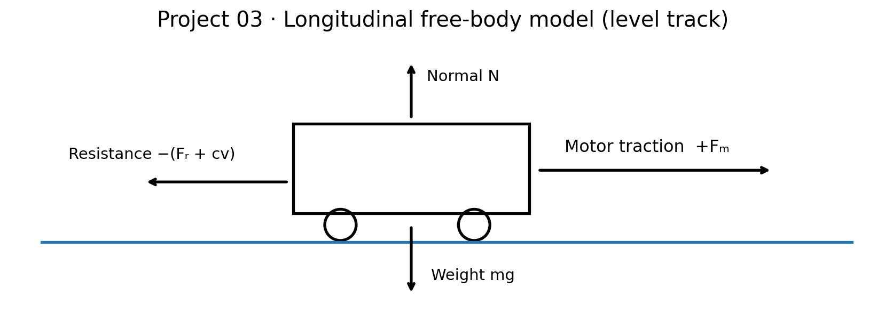
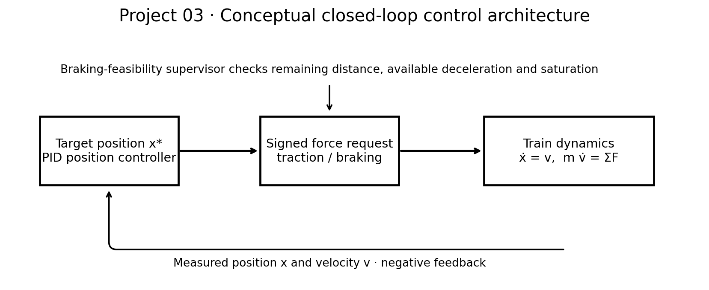
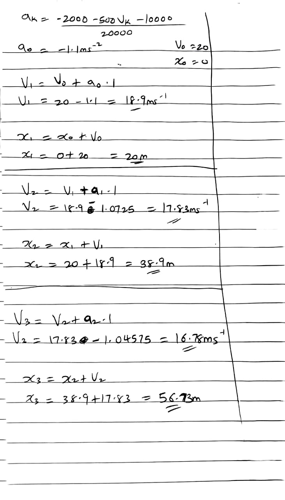
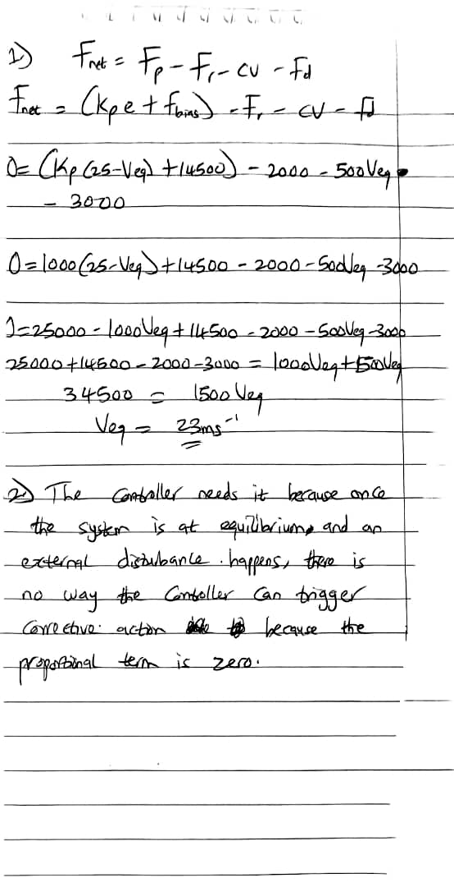
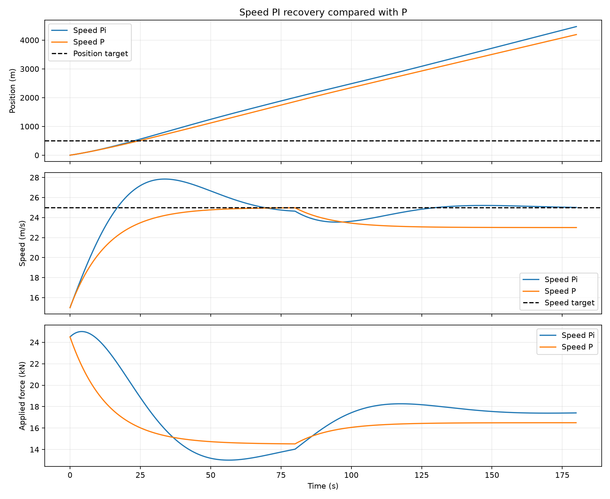
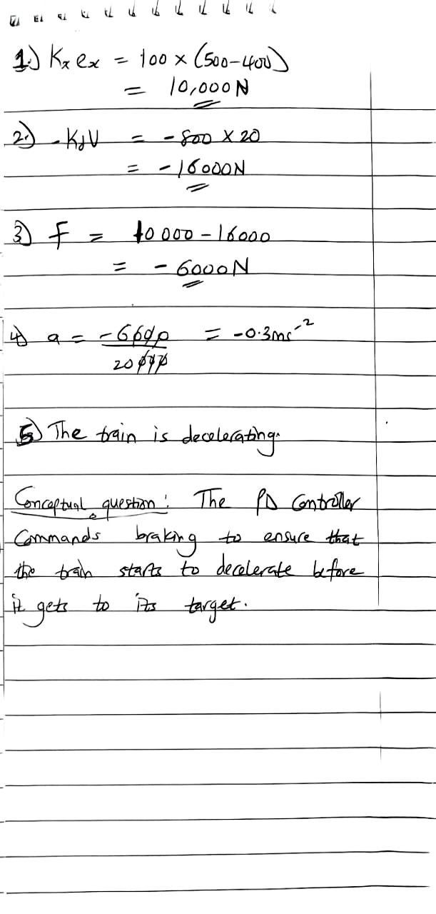
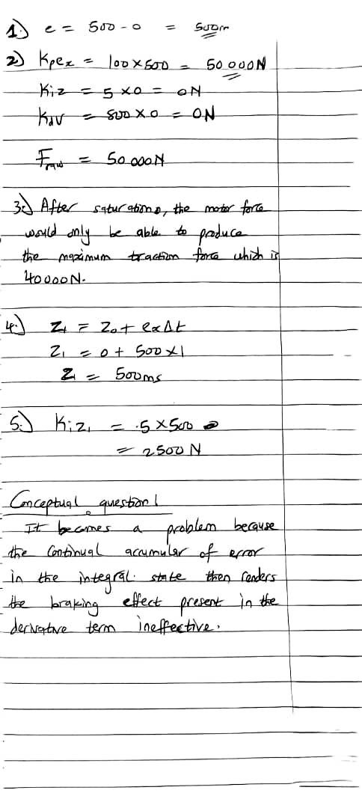
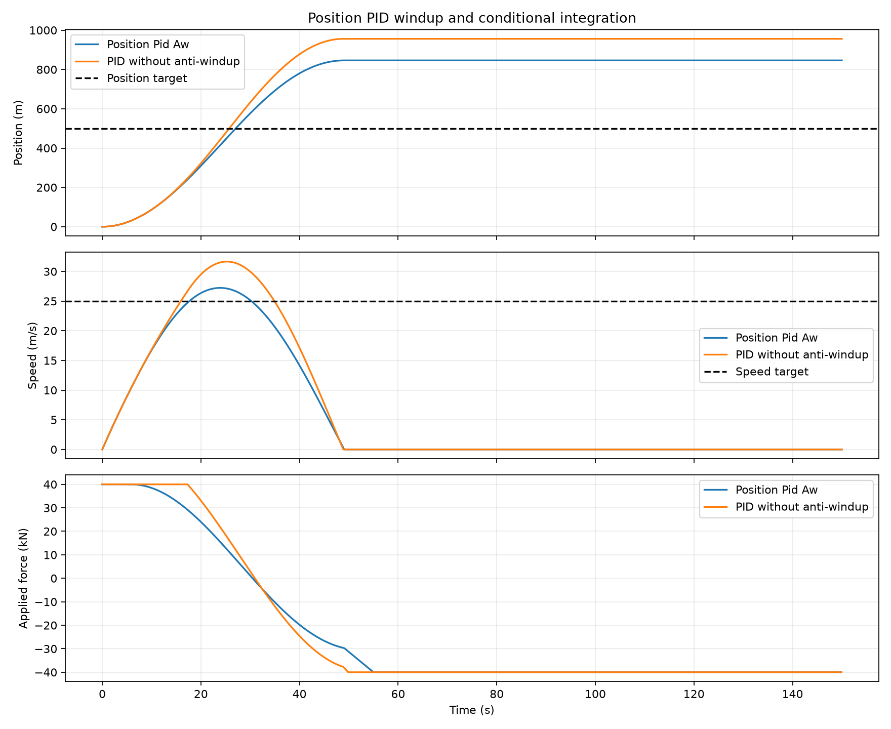
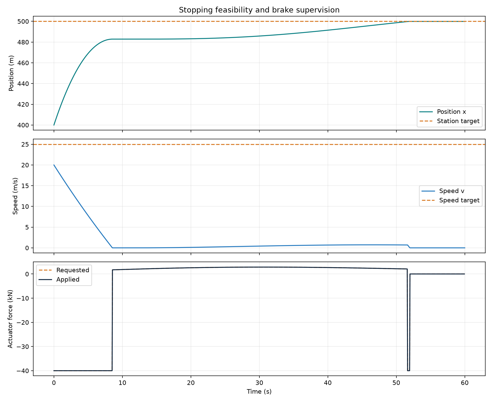
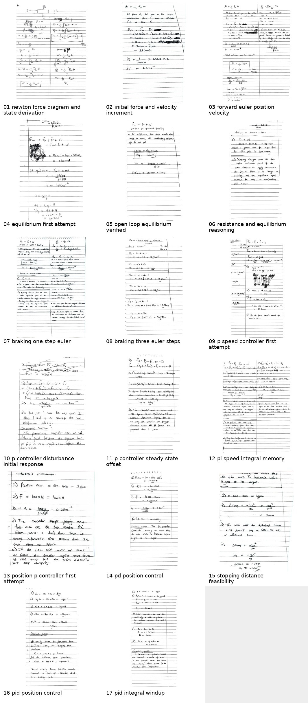

# Train motion, speed regulation, and PID position control

> **03 · Force / speed / position / PID · Engineering learning project**

This project extends the earlier [single-tank](../01-water-tank/README.md) and [coupled two-tank](../02-coupled-two-tank/README.md) work from flow balances to Newton's second law. It models a train that can accelerate, regulate speed, brake, and attempt to stop at a fixed station under separate traction and active-brake limits.

[Open the interactive Train Control Lab](https://control-lab-alpha.vercel.app/train-control) · [Read the web engineering report](https://control-lab-alpha.vercel.app/train-control-report) · [Detailed technical report](TECHNICAL_REPORT.md)

> This is a simplified educational simulation. It is not a high-fidelity railway model and is not certified for train-control or rail-safety decisions.

## Interface critique and revision

The first dashboard version was mathematically consistent but visually over-instrumented: six live equation boxes, six summary cards, five plots, and three open groups of numerical inputs repeated the same state. The supplied architecture and worked calculations suggest a clearer learning sequence—where is the train, how fast is it moving, what signed force is actually applied, and can it stop in the remaining distance?

The interactive page now keeps those four answers visible. Plant constants, gains, limits, and timing remain editable but are collapsed until requested. The separate integral-memory plot and permanent final-outcome card were removed; integral windup is taught with the worked source calculation below, while the final simulated outcome appears in the interpretation panel. Nothing was removed from the underlying model or exported data.



*Source free-body diagram used to check the implementation's force signs. On level track, normal force and weight cancel; traction acts forward and rolling plus velocity-dependent resistance act backward.*

## Problem statement

The controlled plant has two physical states: position \(x\) in metres and forward speed \(v\) in metres per second. The signed actuator command \(u\) is positive for powered traction and negative for active braking. For forward motion on level track,

$$
\dot x=v,
\qquad
m\dot v=u-F_{\mathrm{roll}}-cv-F_d.
$$

The baseline values are teaching assumptions, not measured train specifications:

| Quantity | Baseline | Unit |
|---|---:|---|
| Mass \(m\) | 20,000 | kg |
| Rolling resistance \(F_{\mathrm{roll}}\) | 2,000 | N |
| Linear speed resistance \(c\) | 500 | N·s/m |
| Maximum traction | 40,000 | N |
| Maximum active braking magnitude | 40,000 | N |
| Speed target | 25 | m/s |
| Station position | 500 | m |

The requested force is not assumed to be executable. The plant applies

$$
u_{\mathrm{applied}}=\operatorname{clip}\!\left(u_{\mathrm{requested}},-F_{\mathrm{brake,max}},F_{\mathrm{traction,max}}\right).
$$



*The implementation follows this separation: the position controller requests a signed force, the braking-feasibility supervisor checks whether that request is physically safe to execute, and measured position and velocity close the negative-feedback loop.*

At standstill, negative commands hold the train stopped. A positive request must exceed rolling resistance plus the opposing disturbance before forward acceleration begins. The forward-only solver never permits negative speed or backward displacement.

## Forward Euler and the stop event

Controller, disturbance, resistance, and acceleration are evaluated from the same old sample:

$$
a_k=\frac{u_k-F_{\mathrm{roll}}-cv_k-F_{d,k}}{m},
\qquad
v_{k+1}=v_k+\Delta t\,a_k,
\qquad
x_{k+1}=x_k+\Delta t\,v_k.
$$

If a full Euler step would produce \(v_{k+1}<0\), the solver locates the within-step stop under the constant applied force and linear resistance, advances only to that event, and holds \(v=0\). It does not move the train backward to disguise a large time step.



*The three worked braking steps are regression anchors: \(v_1=18.9\) m/s and \(x_1=20\) m; \(v_2\approx17.83\) m/s and \(x_2=38.9\) m; \(v_3\approx16.78\) m/s and \(x_3\approx56.73\) m. The automated tests reproduce these values using old-state Euler ordering.*

## Controller families

### Speed P and PI

At a speed target \(v_r\), the nominal bias is

$$
F_{\mathrm{bias}}=F_{\mathrm{roll}}+cv_r.
$$

The speed controllers are

$$
u_P=F_{\mathrm{bias}}+K_{p,v}(v_r-v),
$$

$$
\dot z_v=v_r-v,
\qquad
u_{PI}=F_{\mathrm{bias}}+K_{p,v}(v_r-v)+K_{i,v}z_v.
$$

Here \(z_v\) has units of metres and \(K_{i,v}\) has units N/m. With a previously unknown 3,000 N opposing force, the analytical unsaturated P equilibrium is 23 m/s. PI can store the missing force: \(z_{v,eq}=3000/100=30\) m.



*The calculation exposes the P-only limitation: rejecting a constant extra resistance requires a permanent nonzero error. That is the specific problem answered by the PI controller.*



The executed baseline experiment ended at **23.001 m/s for P** and **25.010 m/s for PI** after the disturbance. The PI integral state was **29.232 m** at 180 s and was still converging toward the analytical 30 m equilibrium.

### Position P, PD, and PID

For a fixed station, \(e_x=x_r-x\) and \(\dot e_x=-v\). Therefore

$$
u_P=K_{p,x}e_x,
$$

$$
u_{PD}=K_{p,x}e_x-K_{d,x}v,
$$

$$
\dot z_x=e_x,
\qquad
u_{PID}=K_{p,x}e_x+K_{i,x}z_x-K_{d,x}v.
$$

The derivative term is velocity damping: it opposes a fast approach even while the station remains ahead. The position integral state has units m·s, which is deliberately different from the speed-PI state.



*At \(x=400\) m and \(v=20\) m/s, the +10 kN position term and −16 kN velocity term give a −6 kN braking request and −0.3 m/s² acceleration before passive resistance is included in the plant balance.*

The prescribed learning gains are not a successful station-stop tune. Under the ideal-model comparison from \(x=400\) m and \(v=20\) m/s, PD crossed the station at **17.319 m/s** and stopped at **668.519 m**. PID with \(z_x(0)=200\) m·s crossed at **17.799 m/s** and stopped at **672.895 m**. These poor results are retained because they expose why a tracking controller alone is not a safety guarantee.

## Saturation and conditional anti-windup

At \(x=0\), \(v=0\), and \(x_r=500\) m, the learning PID requests 50,000 N but the actuator can execute only 40,000 N. Conditional integration freezes the integral when its error would drive a saturated request farther outside the feasible range, while allowing it to unwind when the error reverses.



*The unrestricted one-second hand step accumulates \(z=500\) m·s and adds 2.5 kN even though the actuator is already saturated. The implemented conditional anti-windup prevents that outward memory update.*



This baseline deliberately performs badly. Anti-windup reduced the simulated stopping position from the no-protection comparison, but the protected PID still stopped at **846.331 m**, far beyond the 500 m station. Anti-windup manages controller memory; it does not create missing braking distance or a feasible trajectory.

## Stopping feasibility and supervisor

For an assumed constant available net deceleration magnitude \(a_b>0\),

$$
d_{\mathrm{stop}}=\frac{v^2}{2a_b},
\qquad
a_{\mathrm{required}}=\frac{v^2}{2d_{\mathrm{remaining}}}.
$$

At \(x=400\) m, \(v=20\) m/s, and a 500 m station, 1 m/s² needs 200 m, so the state is infeasible within the remaining 100 m. A 2 m/s² constant-deceleration idealization needs exactly 100 m.

The optional supervisor is separate from PID. When the configured feasibility boundary is reached it latches maximum braking until a stop event. After stopping, tracking may make another low-speed approach; inside a documented 0.5 m hold band the supervisor commands zero. In the executed educational scenario the train finished at **499.916 m and 0 m/s**. This is one simulation result—not proof that the method is safe or will always stop exactly at a station.



## Reproducible experiment suite

Nine deterministic experiments cover open-loop traction, braking, speed P/PI, position P/PD/PID, windup, stopping feasibility, and disturbance robustness. Every experiment directory contains:

```text
config.json
metrics.json
timeseries.csv
overview.png
forces.png
[comparison.png]
```

Run them from the repository root:

```bash
PYTHONPATH=projects/03-train-motion-control/src \
MPLBACKEND=Agg MPLCONFIGDIR=.cache/matplotlib \
.venv/bin/python -m train_motion.experiments --all
```

Selected executed results:

| Experiment | Measured result |
|---|---|
| Open-loop 30 kN traction | \(v(240)=55.8868\) m/s; analytical equilibrium 56 m/s |
| Braking from 20 m/s | stopped at 318.837 m absolute position with \(\Delta t=0.1\) s |
| Speed P + 3 kN disturbance | final 23.0011 m/s; analytical equilibrium 23 m/s |
| Speed PI + 3 kN disturbance | final 25.0102 m/s; \(z_v=29.2324\) m |
| Position PD learning baseline | stopped at 668.519 m, not at station |
| Position PID memory case | stopped at 672.895 m, not at station |
| PID + anti-windup stress case | stopped at 846.331 m, not at station |
| Supervised educational case | stopped at 499.916 m, inside the 1 m reporting tolerance |

The robustness experiment also executes 3 kN at 80 s and 6 kN at 60 s disturbance cases, repeats the stronger case at \(\Delta t=0.2,0.1,0.05\) s, and records a deliberately limited 16 kN motor case so saturation is measured rather than merely discussed.

## Verification

The test suite contains named regressions for all supplied hand calculations, plus tests for sign conventions, old-state ordering, positive and negative saturation, standstill, nonnegative speed, monotonic position, stop-event handling, integral units, anti-windup, feasibility, deterministic export, and finite outputs.

```bash
make test-train

# Or directly:
PYTHONPATH=projects/03-train-motion-control/src \
  .venv/bin/python -m unittest discover \
  -s projects/03-train-motion-control/tests -v
```

The browser model is independently checked at selected samples against a fixture generated by the Python simulator:

```bash
cd apps/control-lab
npm run build
```



*The complete source-note contact sheet is retained for traceability. The report and tests use the focused calculations above as verification anchors; typeset equations remain authoritative where handwriting is abbreviated or rounded.*

## Model limits and future work

- Level, straight, forward-only track; no reversing manoeuvre.
- Constant rolling resistance and linear speed resistance, not a high-fidelity aerodynamic law.
- No adhesion limit, wheel slip, grade, delay, jerk constraint, passenger-comfort constraint, or uncertainty model.
- The 40 kN active-brake limit is a configurable experiment assumption.
- The supervisor is educational and uses a simplified constant-deceleration threshold alongside the simulated plant.
- Gains are learning baselines, not industrially optimized values.

Useful extensions include nonlinear resistance, grade, adhesion, actuator lag, jerk-limited speed profiles, a physically feasible trajectory generator, gain studies, and model-predictive longitudinal control.
