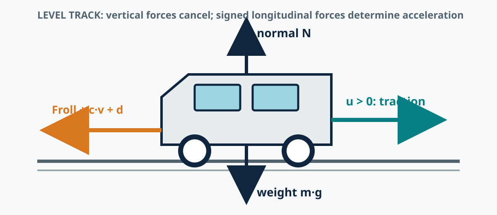
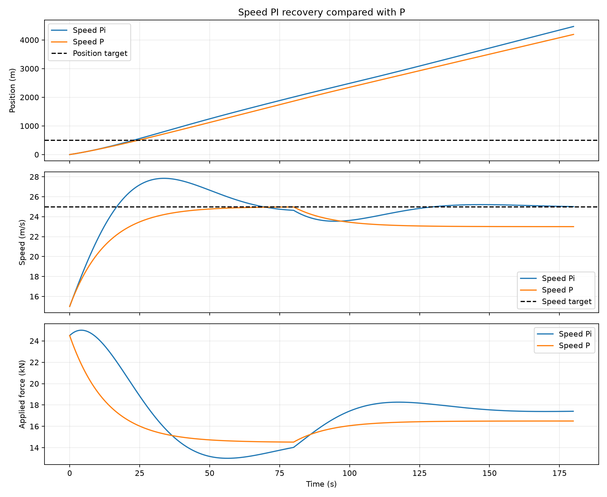
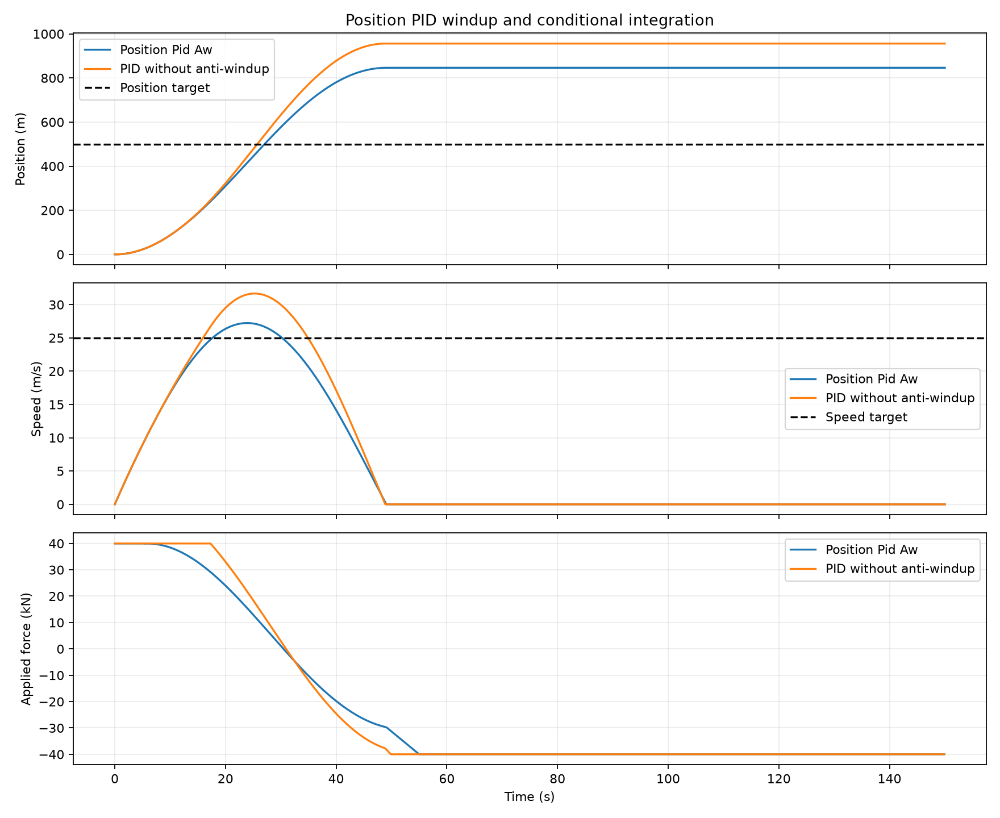
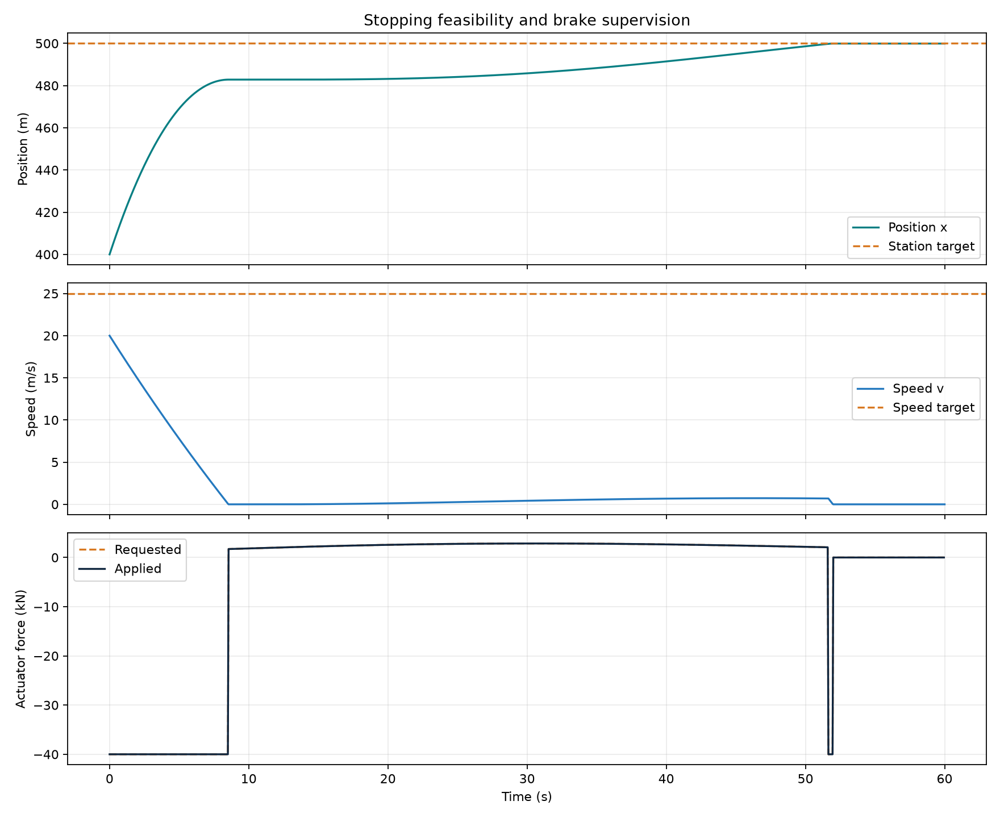

# Technical report — Project 03 train motion and PID control

## 1. Scope and relationship to the earlier projects

Projects 01 and 02 used conservation of liquid volume. Project 03 uses conservation of momentum. The main new distinction is the chain

$$
\text{force}\longrightarrow\text{acceleration}\longrightarrow\text{speed}\longrightarrow\text{position}.
$$

A controller that regulates speed is therefore not the same controller as one that attempts a station stop. This report keeps plant physics, tracking control, actuator limits, anti-windup, and braking feasibility as separate concepts.

## 2. Free-body model and assumptions



On a level track the vertical normal force and weight cancel. Taking forward as positive, the moving longitudinal balance is

$$
\sum F_x=u-F_{\mathrm{roll}}-cv-F_d=m\dot v.
$$

The physical state is \(s=[x,v]^T\), so

$$
\dot s=
\begin{bmatrix}
\dot x\\[2pt]\dot v
\end{bmatrix}
=
\begin{bmatrix}
v\\[2pt](u-F_{\mathrm{roll}}-cv-F_d)/m
\end{bmatrix}.
$$

The model uses SI units. \(F_{\mathrm{roll}}\) and \(F_d\) are newtons; \(c\) is N·s/m, so \(cv\) is newtons. This is a linear teaching approximation, not a claim about detailed train aerodynamics.

At \(v=0\), blindly subtracting constant rolling resistance could generate backward motion. The implemented standstill rule is deterministic:

1. Negative or zero actuator commands hold the forward-only train stopped.
2. A positive actuator command that does not exceed \(F_{\mathrm{roll}}+F_d\) also holds it stopped.
3. A larger positive command produces \(m\dot v=u-F_{\mathrm{roll}}-F_d\).

## 3. Actuator execution and signed braking

The controller produces a requested signed force. The plant executes

$$
u_a=\min(F_{t,\max},\max(-F_{b,\max},u_r)).
$$

The exported data separates raw request, applied signed force, positive traction, positive braking magnitude, passive resistance, disturbance, and net force. A −6 kN request is a 6 kN active-braking request; passive resistance is still subtracted separately while moving.

## 4. Open-loop analytical reference

For constant applied force and disturbance with \(c>0\),

$$
v_{eq}=\frac{u-F_{\mathrm{roll}}-F_d}{c},
$$

$$
v(t)=v_{eq}+(v_0-v_{eq})e^{-ct/m},
$$

$$
x(t)=x_0+v_{eq}t+(v_0-v_{eq})\frac{m}{c}\left(1-e^{-ct/m}\right).
$$

For 30 kN, no disturbance, 2 kN rolling resistance, and \(c=500\) N·s/m, the analytical equilibrium is 56 m/s. The \(\Delta t=0.1\) s Euler run produced 55.8868308 m/s at 240 s. Its error relative to the exact value at that instant was 0.0008534 m/s. Reducing \(\Delta t\) from 1.0 to 0.2 to 0.05 s reduced the final speed error from 0.008374 to 0.001703 to 0.000427 m/s.

## 5. Forward Euler and event-aware stopping

Both states use the same old sample:

$$
v_{k+1}=v_k+\Delta t\,a_k,
\qquad
x_{k+1}=x_k+\Delta t\,v_k.
$$

This ordering reproduces the supplied 2 s traction calculation: from \((x_0,v_0)=(0,10)\), \(a_0=1.15\) m/s², so \(x_1=20\) m and \(v_1=12.3\) m/s.

When Euler predicts a negative next speed, the implementation solves the constant-force, linear-resistance motion inside that step for the stop time and distance. This preserves \(v\ge0\) and monotonic \(x\). In the 10 kN active-braking experiment, the \(\Delta t=0.1\) result stopped at 318.837 m absolute position. Step refinement produced 319.554 m at 0.2 s and 318.473 m at 0.05 s; the event result converges rather than drifting backward.

## 6. Speed regulation

With \(v_r=25\) m/s, the nominal feedforward bias is

$$
F_b=2000+500(25)=14500\ \mathrm{N}.
$$

At \(v=15\) m/s and \(K_{p,v}=1000\) N·s/m, P requests 24,500 N. An unexpected 3,000 N force produces the unsaturated equilibrium

$$
0=14500+1000(25-v)-2000-500v-3000,
$$

which gives \(v=23\) m/s. Simulation produced 23.0011 m/s at 180 s.

For PI,

$$
\dot z_v=v_r-v,
\qquad
u=F_b+K_{p,v}(v_r-v)+K_{i,v}z_v.
$$

The state \(z_v\) integrates m/s over seconds and therefore has units m. At the disturbed target, \(K_{i,v}z_v=3000\) N, so \(z_v=30\) m for \(K_{i,v}=100\) N/m. The finite-horizon simulation ended at 25.0102 m/s and \(z_v=29.2324\) m.



## 7. Fixed-position control and derivative meaning

For \(e_x=x_r-x\), a fixed station has \(\dot e_x=-v\). Thus derivative action is not a numerical derivative of a noisy plotted line in this model; it is direct velocity feedback:

$$
u_{PD}=K_{p,x}e_x-K_{d,x}v.
$$

At \(x=400\) m, \(v=20\) m/s, \(x_r=500\) m, \(K_p=100\) N/m, and \(K_d=800\) N·s/m, P requests +10 kN while PD requests −6 kN. The derivative term recognizes that the train is already approaching quickly.

PID adds

$$
\dot z_x=e_x,
\qquad K_{i,x}z_x,
$$

where \(z_x\) is m·s and \(K_{i,x}\) is N/(m·s). For \(z_x=200\) m·s, the initial components are +10 kN proportional, +1 kN integral, and −16 kN derivative, giving −5 kN.

The prescribed baseline gains do not stop successfully. PD stopped at 668.519 m; PID stopped at 672.895 m. This is an important negative result: feedback structure and physically feasible trajectory planning are different problems.

## 8. Conditional anti-windup

The algorithm computes raw force from the old integral state, clips it, and suppresses \(\dot z\) only when the error would drive the raw request farther into the active saturation limit. It permits integration that unwinds saturation.

The initial 500 m error requests 50 kN, while the plant can execute 40 kN. An unrestricted 1 s controller-only hand step would make \(z_x=500\) m·s and add 2.5 kN. Conditional integration blocks that outward update.



The anti-windup stress run still overshot severely and stopped at 846.331 m. The result demonstrates the precise limitation: anti-windup prevents avoidable memory growth, but it cannot replace a feasible stopping plan.

## 9. Stopping feasibility and supervision

For a constant net deceleration approximation,

$$
d_s=\frac{v^2}{2a_b},
\qquad
a_{req}=\frac{v^2}{2d_r}.
$$

At 20 m/s with 100 m remaining, 1 m/s² needs 200 m and would stop at 600 m from an initial 400 m. The required magnitude is 2 m/s². The constant-deceleration check is a reference estimate; the simulated plant under maximum braking has velocity-dependent passive resistance.

The supervisor does not retune PID or alter the target. It latches maximum braking after a feasibility violation until the next stop event. Tracking can then make a slower approach. A 0.5 m stationary hold band prevents numerical creep at the station. The executed scenario ended at 499.916 m. This behavior is an educational demonstration, not a safety case.



## 10. Results and reproducibility

The `results/` directories persist the exact configuration, metrics, time series, and plots. Blank CSV controller fields mean “not applicable”; they are not fabricated zeros. Integral metadata states whether \(z\) is speed-error memory in metres or position-error memory in m·s.

The robustness record includes two opposing-force cases (3 kN beginning at 80 s and 6 kN beginning at 60 s), timestep repetitions at 0.2, 0.1, and 0.05 s, and a separate 16 kN traction-limited run that records its saturation count and resulting speed.

```bash
make run-train
make test-train
```

The Python suite currently contains 29 Project 03 tests. The browser build additionally compares six selected JS trace samples with the generated Python fixture to a tolerance of \(10^{-8}\).

## 11. Interpretation policy and limitations

Analytical values are called analytical; numerical results are called simulation results; diagrams are explanatory. None is presented as real-train validation. The default gains reproduce learning calculations and are not an optimized industrial tune.

Important omitted effects are nonlinear drag, gradient, adhesion and wheel slip, motor and brake lag, sensor noise, latency, jerk and passenger comfort, reverse motion, uncertainty, and certified fail-safe logic. Future work should begin with a physically feasible velocity profile and jerk/adhesion constraints before considering gain optimization, nonlinear friction, model-predictive control, or autonomous longitudinal control.
